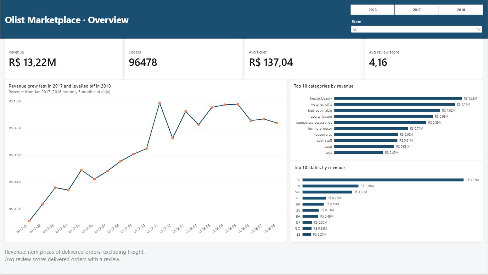
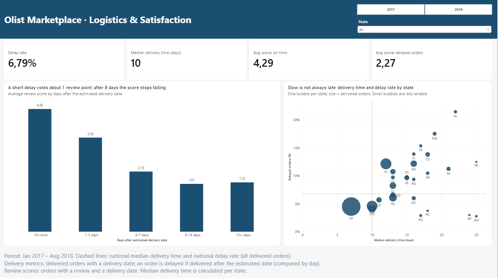

# Olist Marketplace Analytics: Python + SQL + Power BI

End-to-end analysis of about 100,000 orders from the Olist Brazilian e-commerce marketplace (2016-2018). The raw CSV files are cleaned with Python (pandas), loaded into a SQLite database, analysed with SQL and presented in a two-page Power BI dashboard.

**Business questions**

1. How is the business evolving, and where does the revenue come from?
2. Do delivery delays hurt customer satisfaction, and by how much?
3. Where are deliveries slowest?
4. How concentrated is the revenue among sellers?

All amounts are in Brazilian reais (BRL).

---

## Dashboard





---

## Key findings

- **Revenue:** R$ 13.2M from 96,478 delivered orders, with an average ticket of R$ 137.04 (item prices, excluding freight). Monthly revenue grew from R$ 112k in January 2017 to a peak of R$ 988k in November 2017 (7,289 orders), then levelled off between R$ 0.83M and R$ 0.98M per month in 2018. The first half of 2018 was about 2.8 times the first half of 2017. Growth came from the number of orders, not from higher prices: the average ticket stayed between R$ 124 and R$ 149. The November peak could be a Black Friday effect, but the data does not confirm it.
- **Revenue is spread across categories:** 74 categories, led by `health_beauty` (9.3%), `watches_gifts` (8.8%) and `bed_bath_table` (7.7%). The top 5 account for about 40%.
- **Delays hurt reviews.** From January 2017 on, on-time orders have an average review score of 4.29 and delayed orders 2.27. 62% of delayed orders received 1 or 2 stars, against 9% of on-time orders. Even a short delay costs about one point (3.29 for 1-3 days late); the score keeps falling to 2.10 (4-7 days) and 1.67 (8-14 days), then stops falling (1.72 for 15+ days). About 6.8% of delivered orders arrive after the estimated date.
- **Delivery times vary a lot by state.** SP, with 42% of the orders, has a median of 7 days. The slowest states are in the north (RR and AM with 25 days, AP with 24), but they have few orders (40 to 145), so their values are less reliable. Among states with at least 300 orders, the slowest are AL (22 days), PA (21) and MA (19).
- **Slow is not the same as late.** AM and AP are among the slowest states but have only about 3% of delayed orders, while AL, MA and SE have 15% to 21% of delayed orders with 18 to 22 days. A possible explanation is that the estimated delivery dates are longer for remote regions (not tested).
- **Seller concentration:** The top 10 sellers account for 13.27% of the revenue, the top 1% for 25.51%, the top 10% for 67.11% and the top 20% for 82.29%. 127 sellers are enough to reach 50% of the revenue, and 533 to reach 80%.
- **Few customers come back:** only 3.1% of the customers (2,997 of 96,096) bought more than once, so a retention analysis would not be meaningful.

---

## Pipeline

```
data/raw        9 CSV files (Kaggle)
   |
   |  notebooks/02_limpeza.ipynb      pandas: types, nulls, duplicates, metrics, one row per order
   v
data/clean      6 CSV files
   |
   |  notebooks/03_carregar_sql.ipynb SQLite database + indexes
   v
data/olist.db
   |
   |  sql/*.sql                       analysis queries (run in notebooks/04_analise_sql.ipynb)
   v
Power BI        ODBC connection -> model -> DAX measures -> 2 report pages
```

`notebooks/01_exploracao.ipynb` contains the initial exploration of the raw tables.

---

## Data

- **Source:** [Brazilian E-Commerce Public Dataset by Olist](https://www.kaggle.com/datasets/olistbr/brazilian-ecommerce) (Kaggle).
- **Tables:** orders (99,441 rows), order items (112,650), payments, reviews, customers, sellers, products, geolocation and a category translation table.
- **Period:** September 2016 to August 2018. The monthly trend starts in January 2017: 2016 has only three months of data (267 delivered orders, 0.3% of the revenue) and one month is missing, so month-over-month comparisons would be meaningless.

---

## Cleaning decisions (`02_limpeza.ipynb`)

| Issue | Decision | Why |
|---|---|---|
| Dates stored as text | Converted to datetime | Needed for date arithmetic |
| 2,965 orders without delivery date | Kept as missing | 2,957 are consistent with their status (not delivered yet, canceled, unavailable) |
| 23 `delivered` orders (0.02%) with at least one date missing | Kept | They are real sales; they drop out of the delivery metrics automatically |
| 6 `canceled` orders with a delivery date | Kept in delivery analysis, excluded from revenue | The delivery happened, but the sale was canceled (possibly a return) |
| 547 orders with more than one review | Kept the review with the most recent `review_answer_timestamp` (551 rows removed) | Reflects the final opinion; the timestamp has time precision, so there are no ties |
| `geolocation`: 1,000,163 rows for 19,015 zip prefixes | One row per prefix with the median latitude and longitude | A direct join with customers produced 15,083,455 rows (99,441 customers) and would inflate any total |
| 278 customers (0.28%) without coordinates | Kept with missing coordinates | Deleting them would remove customers and revenue; they only miss from maps |
| 610 products without category | `unknown` in the English column; the Portuguese column is unchanged | They still have sales |
| 2 categories missing from the translation table | Translated manually | The category exists, only the translation is missing |
| Items, payments and reviews repeat per order | Aggregated to one row per order **before** joining | Joining raw tables multiplies rows and inflates revenue |
| Nulls created by the joins | `n_item` = 0; `items_value`, `freight`, `total_paid` and `review_score` stay missing | A count of zero items is real; a revenue or a score of 0 would be false data |
| 576 orders (0.6%) where the amount paid differs from items + freight | Revenue is the sum of item prices, not the amount paid | Payments can include installment interest or vouchers (not investigated) |

**Delay metric:** the delivery date is compared with the estimated date by day, so an order delivered on the estimated day is not late. Orders never delivered are missing (`NA`), not `False`, otherwise the delay rate would be underestimated.

### Analysis scopes

The same table answers different questions, so no rows were deleted. Three boolean flags define which orders enter each analysis:

| Flag | Definition | Used for |
|---|---|---|
| `in_revenue` | `order_status = delivered` (96,478 orders) | Revenue and number of orders |
| `in_delivery_analysis` | Has a delivery date (96,476 orders) | Delivery time and delay rate |
| `in_review_analysis` | Delay is defined and the order has a review (95,561 orders from January 2017) | Review score vs. delay |

**Revenue** = sum of item prices of delivered orders, excluding freight. It is calculated at item level because an order can contain items from several sellers and categories, and the order total would be repeated once per item.

---

## SQL analysis (`sql/`)

| File | Question |
|---|---|
| `01_revenue_by_category.sql` | Which categories generate the most revenue? |
| `02_monthly_orders_revenue.sql` | How do orders and revenue evolve per month? |
| `03_delay_vs_review.sql` | Do delayed orders get worse reviews? |
| `03b_delay_buckets_vs_review.sql` | How does the score change with the number of days of delay? |
| `04_delivery_by_state.sql` | Which states have the slowest deliveries? |
| `05a_seller_ranking.sql` | Revenue, share and cumulative share per seller |
| `05b_seller_concentration.sql` | How concentrated is the revenue among sellers? |

Each file starts with a header describing the question, the scope and the grain of the result.

---

## Power BI (`powerbi/olist_dashboard.pbix`)

**Connection.** Power BI has no native SQLite connector, so the database is read through a SQLite ODBC driver (import mode). Four tables are loaded: `orders`, `order_items`, `products` and `customers`.

**Model**

| Table A | Table B | Column | Cardinality
|---|---|---|---|
| `Calendar` | `orders` | `Date` / `purchase_date` | one-to-many |
| `orders` | `order_items` | `order_id` | one-to-many |
| `products` | `order_items` | `product_id` | one-to-many |
| `customers` | `orders` | `customer_id` | one-to-one |

**Measures.** Every measure carries its scope inside the formula, so no visual depends on manual filters.

| Measure | Definition | Scope | Validated value |
|---|---|---|---|
| `Revenue` | Sum of item prices | Delivered orders | R$ 13,221,498.11 |
| `N_Orders` | Distinct orders in `order_items` | Delivered orders | 96,478 |
| `Avg_ticket` | `Revenue` / `N_Orders` | Delivered orders | R$ 137.04 |
| `Delay_rate` | Share of orders delivered after the estimated date | `in_delivery_analysis` | 6.77% (all periods), 6.79% (2017-2018) |
| `Avg_delivery_days` | Average days from purchase to delivery | `in_delivery_analysis` | by state, e.g. RR 29.0, SP 8.3 (all periods) |
| `Median_delivery_days` | Median days from purchase to delivery | `in_delivery_analysis` | by state, e.g. RR 25, SP 7 (all periods) |
| `Avg_review_score` | Average review score | `in_review_analysis` | 4.16 (from January 2017) |
| `Avg_score_on_time` / `Avg_score_delayed` | `Avg_review_score` split by delay | `in_review_analysis` | 4.29 / 2.27 (2017-2018) |
| `Delivered_orders` | Number of orders with a delivery date | `in_delivery_analysis` | 96,476 |

**Validation.** Every number in the dashboard was checked against the SQL queries (the report has a hidden `Validation` page). The totals, the monthly values, the category and state tables and the review scores match.

**Interactivity.** The year and state slicers apply to the whole report. Selecting a delay bucket in the column chart also filters the cards and the scatter plot; since a bucket defines which orders are late, the delay rate becomes 100% by construction in that view.

---

## Limitations

- **Association, not causation.** Delayed orders have much lower scores, but the analysis cannot separate the delay from other factors (product, seller, region).
- **Small states.** States such as RR, AP and AM have a few dozen to a few hundred orders, so their averages are unstable.
- **Delay is relative to the estimated date**, which seems to differ between regions; this is why slow states can have a low delay rate (hypothesis, not tested).
- **Revenue** excludes freight and orders not delivered, and there is no cost or profit data.
- **Retention** was not analysed: only 3.1% of the customers bought more than once.
- **Scope of the data:** one marketplace, anonymized, 2016-2018.

---

## Repository structure

```
.
├── data/                  
│   ├── raw/               
│   ├── clean/             
│   └── olist.db           
├── notebooks/
│   ├── 01_exploracao.ipynb
│   ├── 02_limpeza.ipynb
│   ├── 03_carregar_sql.ipynb
│   └── 04_analise_sql.ipynb
├── sql/                   analysis queries
├── powerbi/               olist_dashboard.pbix
├── images/                dashboard screenshots
├── requirements.txt
└── README.md
```

---

## How to reproduce

1. Clone the repository and create the environment:
   ```
   python -m venv .venv
   .venv\Scripts\activate
   pip install -r requirements.txt
   ```
2. Download the dataset from Kaggle and place the CSV files in `data/raw/`.
3. Run `notebooks/02_limpeza.ipynb` (creates `data/clean/`) and then `notebooks/03_carregar_sql.ipynb` (creates `data/olist.db`).
4. Run the queries in `sql/` with `notebooks/04_analise_sql.ipynb`.
5. For the dashboard, install the 64-bit SQLite ODBC driver, create a DSN named `olist` pointing to `data/olist.db`, and open `powerbi/olist_dashboard.pbix`. If the connection fails, update the data source in *Transform data > Data source settings*.

The `data/` folder is not versioned: raw and clean data can be regenerated with the notebooks.

---

## Tools

Python (pandas, sqlite3, Jupyter), SQLite, SQL (CTEs, window functions), Power BI Desktop (Power Query, DAX).

